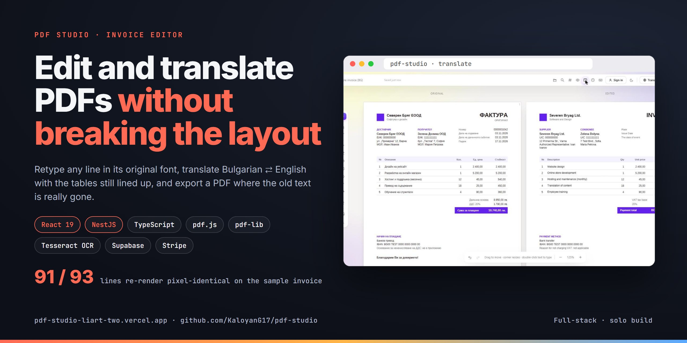
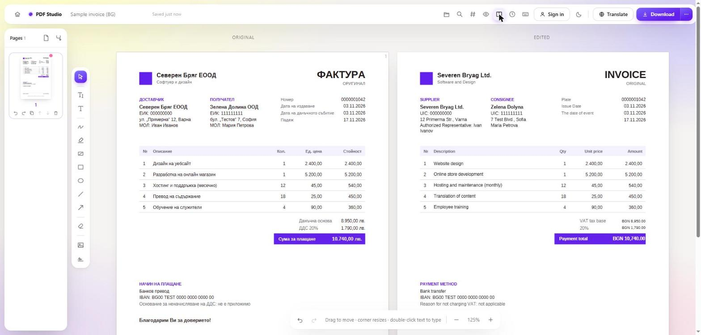
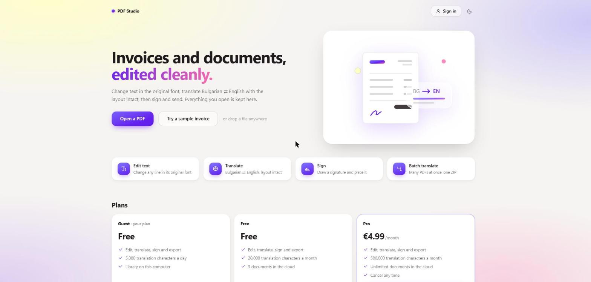
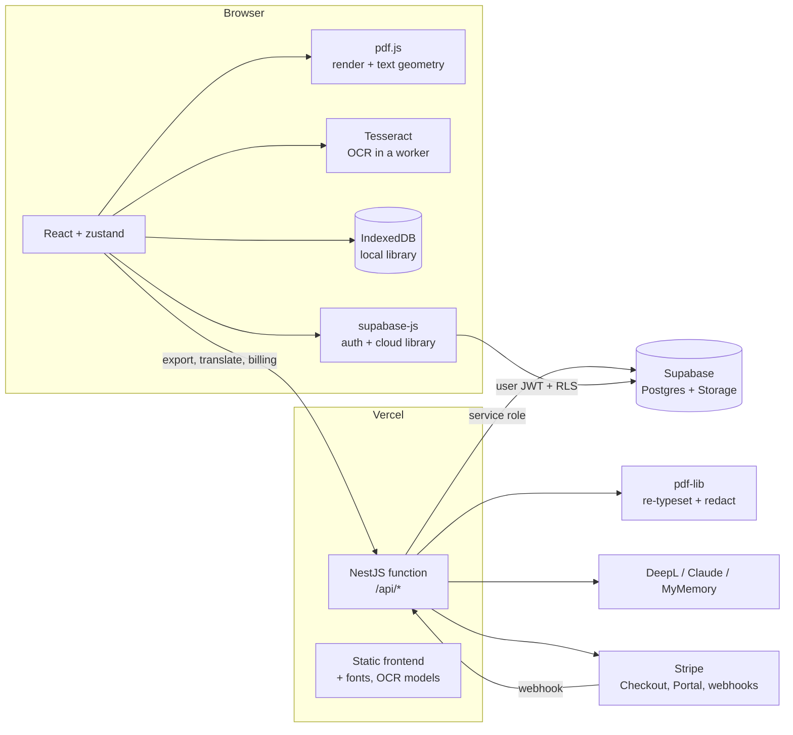

<a href="https://pdf-studio-liart-two.vercel.app"></a>

<p align="center">
  <a href="https://pdf-studio-liart-two.vercel.app"></a>
  
  
  
  
  
</p>

**Edit and translate invoices without breaking their layout.** Open a PDF, retype any line in its original font, translate Bulgarian ⇄ English with the table still lined up, sign it, and download a real PDF where the old text is actually gone.

**[Live demo →](https://pdf-studio-liart-two.vercel.app)**: click *Try a sample invoice*, no sign-up needed.



React 19 · TypeScript · NestJS 12 · pdf.js · pdf-lib · Tesseract (OCR) · Supabase (Postgres, auth, storage) · Stripe · Vercel

---


## 01 · Why this is hard

Most "PDF editors" put a white box over the old text and type on top in Arial. Your invoice then has a different font, wobbly baselines, and the original text is still in the file for anyone to copy out. PDF Studio solves the underlying problems:

| Problem | What PDF Studio does |
| --- | --- |
| **The new text doesn't look like the old text** | Reuses the PDF's own embedded font when it has every glyph needed. Otherwise it switches to a *metric-compatible* substitute (Liberation for Arial/Times/Courier, Carlito for Calibri), so widths and line breaks match. Text is placed on the original baseline, with the original word and character spacing. On the sample invoice, **91 of 93 lines re-render pixel-identical**. |
| **Covered text is still in the file** | On export the backend parses the page's content stream, removes the glyphs under each edit, and swaps them for equivalent `TJ` advances, so the rest of the line stays exactly in place ([`redact.ts`](backend/src/pdf/redact.ts)). The old text can't be copied, searched or extracted. |
| **Translations are longer than the original** | A translated paragraph first grows into free space beside or below it, which is found by checking the rendered pixels for table-cell borders. The font shrinks only when there's no room. Dates and numbers are converted to the target language's format, glossary terms are protected, and ALL CAPS stays ALL CAPS. |
| **Scans have no text** | In-browser OCR (Bulgarian + English) with font sizes measured from the ink, plus a fix for Latin letters that look like Cyrillic ones (OCR often reads "на" as "Ha"). Exported scans get an invisible, searchable text layer. |

## 02 · Product



- **Automatic direction.** The document's language is detected from its own text, offline: script, letters unique to one language, and common words. A Bulgarian invoice is offered Bulgarian → English and an English one English → Bulgarian. Batch translation decides per file, so a mixed folder works.
- **Library** with autosave, version history, side-by-side comparison with the original, and back/forward-friendly URLs (`/doc/:id`).
- **Accounts and cloud library** (Supabase): sign in and your documents follow you to any computer.
- **Plans and billing** (Stripe, test mode). Upgrade through Stripe Checkout, manage the subscription in the Stripe customer portal, and a webhook keeps the plan in sync.

| Plan | Translation | Cloud documents |
| --- | --- | --- |
| Guest | 5,000 characters / day | this computer only |
| Free account | 20,000 characters / month | 3 |
| Pro (€4.99/month) | 500,000 characters / month | unlimited |

> The demo's Stripe runs in **test mode**: upgrade with card `4242 4242 4242 4242`, any future date and any CVC. No real money moves.

Plus: find & replace, glossary and translation memory, batch translation to a ZIP, drawing, shapes and highlights, whiteout, signatures, images, page numbers, watermarks, and merging, splitting, rotating and reordering pages.

## 03 · Architecture



**Security model.** The browser only ever holds the public Supabase key and the user's JWT. Every table and the storage bucket use **row-level security**: a user can only read their own rows and their own `<user id>/…` folder. The browser can't change its own plan, because the `profiles` table has no update policy. The free plan's 3-document limit is enforced **in Postgres**, in an insert policy, so it can't be bypassed from the client. Translation quotas are metered by an atomic `consume_usage()` SQL function, so parallel requests can't overshoot. Guests are counted by a salted hash of their IP; no IPs are stored. Stripe webhooks are verified against the raw request body. See [`supabase/migrations/001_accounts.sql`](supabase/migrations/001_accounts.sql).

**Serverless NestJS.** Nest 12 ships as ES modules, and Vercel's function loader can't `require()` ESM. So the backend is bundled into a single CommonJS file with esbuild ([`backend/package.json`](backend/package.json) `bundle` script). That file runs behind one Vercel Function (`api/index.js`), and a rewrite sends every `/api/*` request to it. The same Nest app also runs as a normal server locally.

```
backend/src
  pdf/        export: copy pages → redact covered text → draw edits → OCR layer → watermark
  translate/  DeepL, Claude and MyMemory providers, quota-checked
  account/    Supabase (auth, profiles, quotas), Stripe billing, webhooks
  fonts/      serves the metric-compatible substitute fonts
frontend/src
  lib/        pdf.js text extraction, translation pipeline, OCR, glossary, IndexedDB library, cloud sync
  components/ editor, toolbar, dialogs, home/library, account and pricing
supabase/migrations   schema, RLS policies, quota function
```

## 04 · Run it locally

```bash
npm install
npm run dev            # web on http://localhost:5173, API on :3001
```

Everything works without any keys: local library, the free MyMemory translation engine, no accounts. To turn on accounts and billing, link the project to Vercel. The Supabase and Stripe Marketplace integrations provide every variable:

```bash
vercel link
vercel env pull        # writes .env.local, which the API reads
npm run db:migrate     # applies supabase/migrations to the database
```

Optional, in `backend/.env`: `DEEPL_API_KEY` (the best quality for Bulgarian) or `ANTHROPIC_API_KEY`. For the live Stripe webhook, run `node scripts/setup-stripe-webhook.mjs <site url>` and store the printed secret as `STRIPE_WEBHOOK_SECRET`.

## 05 · Tests

```bash
npm test                                                # export fidelity: 6 tests
API_URL=http://localhost:3001 node backend/test/accounts.e2e.mjs   # accounts, RLS, quotas, billing: 10 tests
```

- **Fidelity** (generated invoice-like PDF): re-typesetting every line reproduces it within 0.05 pt and removes the original. Centred and right-aligned edits keep their anchor. Whiteout removes text but a highlight doesn't. Partial removal keeps the rest of the line in place. The watermark follows the page diagonal. The OCR layer is searchable.
- **Accounts** (against the real Supabase project, with a throwaway user that is deleted afterwards): only public keys are exposed. The browser can't upgrade itself. The 4th free cloud document is rejected by RLS. Writing to another user's folder fails. Translation is metered, and requests over the quota get `402`. Checkout returns a Stripe URL. Unsigned webhooks are rejected.

## 06 · Limits

- Redaction doesn't reach text inside form XObjects, Type3 fonts without metrics, or text that is part of an image. Vector graphics and images under a whiteout are covered, not removed.
- Changing a line item doesn't recalculate the invoice totals.
- No PDF form filling, password protection or compression yet.
- Sign-up creates confirmed accounts directly, through the API, instead of sending confirmation e-mails. Supabase's built-in mailer is limited to a few messages an hour. A production deployment would use its own SMTP and e-mail verification.

## License

[MIT](LICENSE). The sample invoice in `frontend/public/samples/` is generated by `scripts/make-sample.mjs`; all of its data is fictional.

---

<p align="center"><sub>Designed and built by <a href="https://github.com/KaloyanG17">Kaloyan Gaydarov</a> · <a href="https://www.linkedin.com/in/kaloyan-gaydarov/">LinkedIn</a></sub></p>
